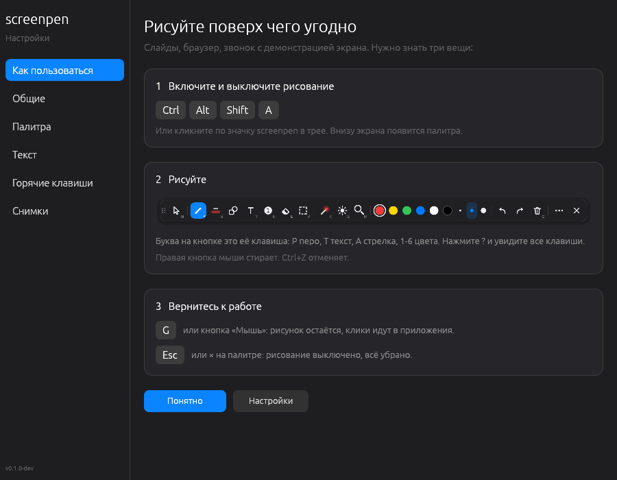
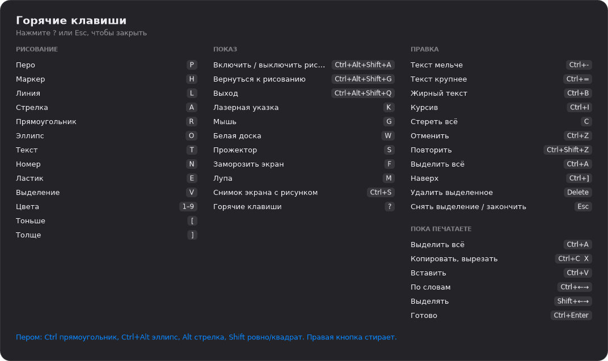

<p align="center"></p>

# screenpen

Draw on top of the screen during presentations, demos, calls and screen recordings.
Windows, macOS and Linux. Free and open source (MIT).

A Rust port of [ScreenInk](https://github.com/volyx/ScreenInk) by volyx, ported with the author's permission.


## Install

Downloads are on the [Releases](https://github.com/IvanKhramov/screenpen/releases) page.

**Windows 10/11.** Run `screenpen-<version>-windows-x64-setup.exe`. It installs for your user
only (no administrator prompt), adds screenpen to the Start menu, can start it when you sign in,
and is removed from Settings → Apps. Prefer no installer? Take `...-portable.exe` and run it
from anywhere.

The builds are not code-signed yet, so Windows warns about an unknown publisher the first time:
click **More info → Run anyway**.

**macOS 13 or later, Apple Silicon.** Open `screenpen-<version>-macos-arm64.dmg` and drag
screenpen to Applications. The app is not notarized by Apple, so the first launch is blocked:
open **System Settings → Privacy & Security**, scroll down and click **Open Anyway** (or run
`xattr -dr com.apple.quarantine /Applications/screenpen.app`). Freeze, snapshots and the
magnifier ask for the Screen Recording permission; drawing doesn't need it.

**Linux x64.** Unpack `screenpen-<version>-linux-x64.tar.gz` and run `./install.sh` in it:
the app goes to `~/.local/bin`, with an icon and a menu entry (`./install.sh --remove` undoes it).
See [Linux notes](#linux-notes) for X11 and Wayland.

## First steps

The first start opens a short getting-started page. In short:

1. **Ctrl+Alt+Shift+A** (or a click on the tray icon) turns drawing on and off. The palette
   appears at the bottom of the screen.
2. **Draw.** The letter in a button's corner is its key: P pen, H highlighter, T text, A arrow,
   1-6 colors. The cursor shows the brush: its color and width. The right mouse button erases,
   Ctrl+Z undoes. Press **?** for all shortcuts.
3. **G** (or the Mouse button) gets your mouse back: the drawing stays, clicks go to your apps.
   **Esc** or **×** turns drawing off and hides everything.



## The palette

From left to right: Mouse; pen, highlighter, shapes, text, numbered badge, eraser, select;
laser pointer, spotlight, magnifier; colors and S/M/L widths; undo, redo, clear; and `⋯` for
the rest (whiteboard, freeze, screenshot, shortcuts, settings). Shapes share one button with a
row of kinds above it; the text tool gets a row with size, bold and italic.

Drag the palette by its dots (it snaps to screen edges), double-click them to turn it vertical,
Ctrl+wheel over it to resize everything. Light or dark follows the system, or pick one in settings.
The buttons, their order and the orientation are up to you: Settings → Palette.

The tray icon is the app icon; a red dot means drawing, a purple one mouse mode. Its menu has
the whiteboard, dimming, fading, start at sign-in, settings and quit.

## Text

Click with the text tool and type. Text edits like any text field: arrows, Home/End,
Ctrl+arrows by words, Shift selects, the mouse places the caret and drag selects, double-click
selects a word, Ctrl+A/C/X/V, Ctrl+Z/Y inside the text, Enter for a new line, Ctrl+Enter or Esc
to finish. Ctrl+= and Ctrl+- (or Ctrl+wheel) change the size,
Ctrl+B and Ctrl+I bold and italic. Font, plate and outline are in Settings → Text. Double-click
existing text with the select tool to edit it.

## Shortcuts



On a Mac, Cmd does everything Ctrl does below (Cmd+Z, Cmd+drag for the magnet, the
Cmd+Alt+Shift+A global shortcut), and the app shows Cmd in its hints. In text, Alt+arrows move
by words and Cmd+arrows to the line ends.

| Key | Action |
|---|---|
| Ctrl+Alt+Shift+A | Drawing on / off |
| P · H · L · A | Pen · Highlighter · Line · Arrow |
| R · O · T · N | Rectangle · Ellipse · Text · Numbered badge |
| E · V · K · B | Eraser · Select · Laser pointer · Pixelate (hides what's under it) |
| 1-9 | Color (recolors the selection when one exists) |
| `[` · `]` · Ctrl+wheel | Thinner · Thicker |
| Shift+1-3 · Ctrl+Shift+1-3 | Saved style (tool, color, width) · save the current one there |
| Enter | Right after an arrow: type a caption at its tail |
| C | Clear |
| Ctrl+Z · Ctrl+Shift+Z | Undo · Redo |
| Ctrl+A · Ctrl+] · Delete | Select all · Bring to front · Delete the selection |
| W · S · F | Whiteboard · Spotlight (wheel resizes it) · Freeze the screen |
| M | Magnifier (wheel zooms; Windows and macOS) |
| Ctrl+S | Screenshot with the drawing: saved to Pictures/screenpen and copied |
| Ctrl+T | Timer in the corner (length in Settings; click it to pause) |
| G · Ctrl+Alt+Shift+G | Mouse mode: the drawing stays, clicks go through · back to drawing |
| PgUp · PgDn · arrows | Sent to the window behind (flip slides; Windows and Linux X11) |
| Esc | Finish typing, deselect, or stop drawing |
| ? | All shortcuts |
| Ctrl+Alt+Shift+Q | Quit |

With the pen: hold Ctrl for a straight line along the magnet, Ctrl+Alt for such an arrow, Alt for an arrow. Shift makes
lines snap to 45° and shapes square. Alt with the arrow tool bends the arrow. Hold the right mouse
button (or use a pen's eraser end) to erase with any tool. Pen pressure changes the width.
Hold the pen still for half a second at the end of a stroke and a wobbly line, box or circle
becomes a straight line, rectangle or ellipse.

Magnet: with Ctrl held, rectangles, ellipses, lines, arrows (the pen's Ctrl lines too) and pixelation stick to the edges of
windows, panels and buttons on the screen, and cyan guides show the edge. Ctrl+click without
dragging frames the box under the pointer (pixelates it with B; with the spotlight on, lights just
that box); a dashed outline shows it before you click. The magnet and pixelation look at
a capture of the screen: on macOS it needs the Screen Recording permission, on X11 the drawing
blinks once when it takes it, and native Wayland overlays (KDE, Sway, Hyprland) have no capture,
so there is no magnet there (pixelation draws plain grey blocks instead).

Show clicks and keys (More menu): in mouse mode, a ring shows where each click lands and a pill in
the corner shows shortcuts like Ctrl+C or F5. Plain typing is never shown. Windows and X11 only
need it turned on; macOS shows keys after Accessibility is allowed for screenpen; Wayland can't.
Keys are physical: P is the pen on any keyboard layout. Every shortcut can be changed or turned
off in Settings → Shortcuts.

## Snapshots

Ctrl+S saves the screen with the drawing to `Pictures/screenpen` and copies it. Settings →
Snapshots lists them: Restore puts a snapshot back on screen, frozen, with the drawing editable;
PDF exports the drawing as vectors over the screen image. From a script:
`screenpen --restore <snapshot-name>`.

## Where things are

| | Settings | Log |
|---|---|---|
| Windows | `%APPDATA%\screenpen\settings.toml` | `%TEMP%\screenpen.log` |
| macOS | `~/Library/Application Support/screenpen/settings.toml` | `$TMPDIR/screenpen.log` |
| Linux | `~/.config/screenpen/settings.toml` | `$XDG_RUNTIME_DIR/screenpen.log` |

## Linux notes

- X11 needs a compositing manager for a see-through overlay; without one the screen goes black
  while drawing.
- KDE Plasma, Sway and Hyprland on Wayland get native overlays. Wayland has no global hotkeys:
  bind `screenpen --toggle` to a shortcut in your desktop settings, or use the tray icon.
  Freeze, the screen under a snapshot and passing PageUp/PageDown to the app behind need X11.
- GNOME on Wayland runs screenpen through XWayland; native Wayland windows may stay above the
  drawing. The tray icon on GNOME needs the AppIndicator extension.
- No pen pressure, magnifier or brush cursor on Linux yet.

## Build from source

Rust stable (see `rust-toolchain.toml`):

```sh
cargo run --release -p screenpen
scripts/bundle-macos.sh                          # macOS: wraps the binary into screenpen.app
cargo run -p screenpen-core --example icon -- assets   # redraws the icon files
```

The Windows installer is built by CI with Inno Setup from `packaging/windows/screenpen.iss`.
How the code is laid out and how to check changes: [AGENTS.md](AGENTS.md); plans and decisions:
[PLAN.md](PLAN.md).

## License

MIT
